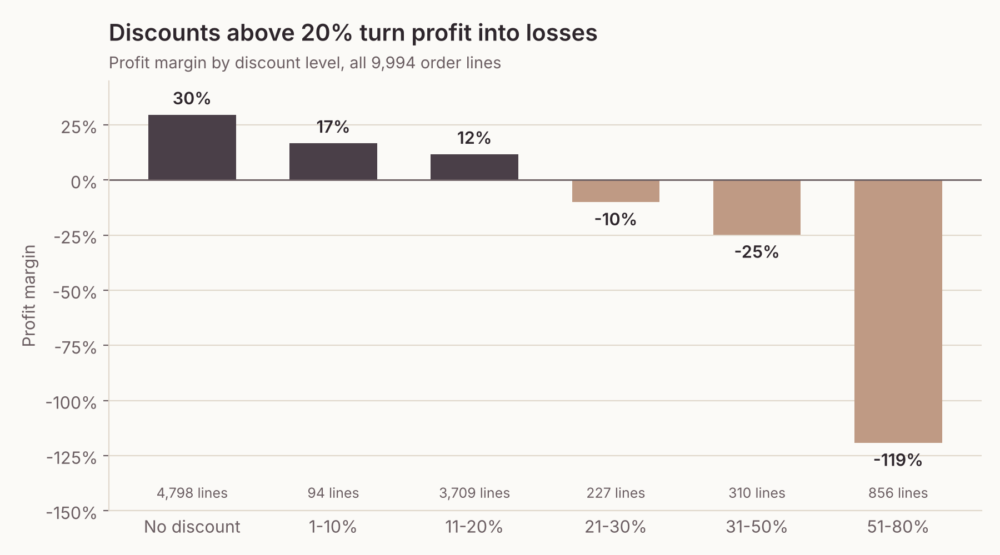
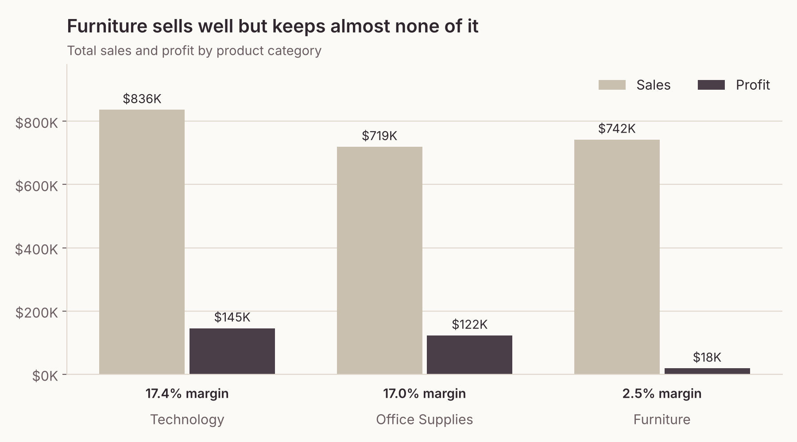
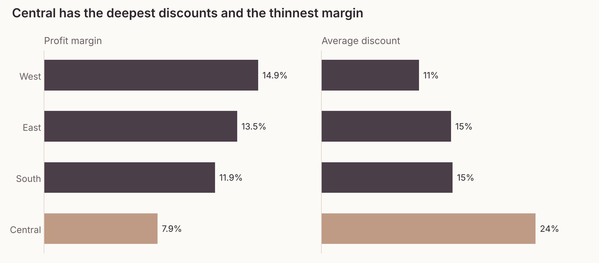
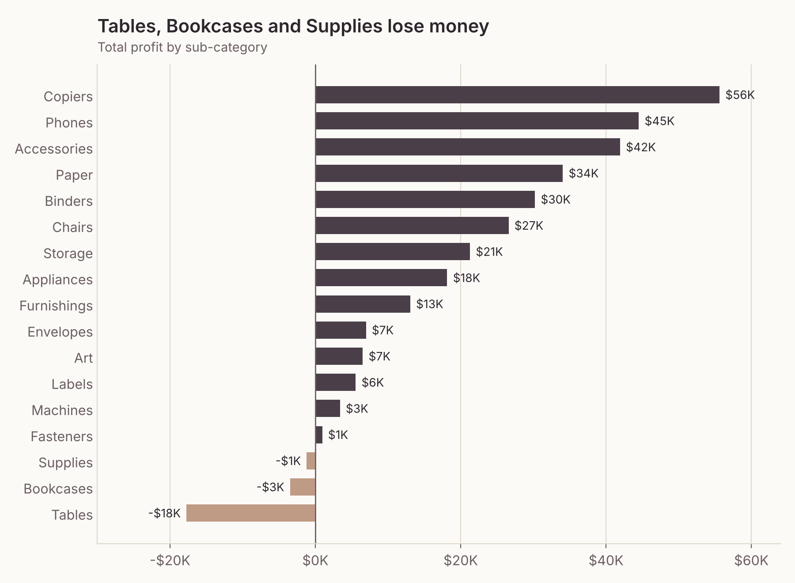

# Superstore Sales Analysis: Where Discounts Eat the Profit

A national office-supply retailer sold **$2.30 million** and kept **$286,000** in profit, a 12.5% margin. I analyzed nearly 10,000 order lines to find where that profit comes from and where it leaks away.

**The short answer:** discounting. Order lines discounted more than 20% lost money at every discount level, and together they erased **$135,000** in profit, about a third of what the store would otherwise have kept.



## The business question

Revenue looks healthy, but a 12.5% margin is thin for office products. Leadership wants to know:

1. Which products, regions and customer segments earn the most profit, not just the most sales?
2. Where is the store losing money, and why?
3. What should change to protect profit without hurting sales?

## The data

| | |
|---|---|
| **Dataset** | Sample Superstore, the practice dataset Tableau publishes. I used the copy packaged with the open-source [Bokeh](https://github.com/bokeh/bokeh) library (`bokeh.sampledata.sample_superstore`), released under a CC0 public-domain license. |
| **Size** | 9,994 order lines across 49 U.S. states |
| **Fields** | ship mode, segment, city, state, postal code, region, category, sub-category, sales, quantity, discount, profit |
| **Limits** | This version has no order dates or order IDs, so it can't show trends over time or delivery speed, and it can't tell a true duplicate from two identical items on one order. |

## Process

I followed the six-step data analysis process: ask, prepare, process, analyze, share, act.

**Cleaning**
- Checked every column for missing values (none) and impossible values such as negative sales or discounts over 100% (none).
- Restored the leading zero on 449 New England postal codes (for example 1852 back to 01852) by storing postal codes as text.
- Found 17 rows that exactly copy another row. With no order IDs there's no way to tell a real duplicate from two identical purchases, so I kept them and confirmed they move total sales and profit by less than 0.1%.
- Added three helper columns: profit margin, discount band and a flag for lines that lost money.

**Analysis**
- Compared profit margin (profit as a share of sales) by region, category, sub-category, segment, ship mode and state.
- Grouped order lines into six discount bands to find where discounts stop paying for themselves.
- Tested whether the losing products and regions were the same ones getting the deepest discounts.

## Key findings

### 1. Discounts above 20% turn profit into losses
Lines with no discount earned a 30% margin. Margin shrinks as discounts grow, and past 20% it turns negative at every level, down to a 119% loss on lines discounted 51 to 80%. The 1,393 lines discounted more than 20% are 14% of all lines but lost $135,000 combined.

### 2. Furniture sells well but keeps almost none of it
Furniture brings in $742,000, nearly a third of sales, but only $18,000 in profit, a 2.5% margin. Technology and Office Supplies each earn about 17%. Tables are a discount story, not a product problem: they earned $13,000 on lines discounted 20% or less and lost $30,700 on the 55% of lines discounted more deeply.



### 3. Central has the deepest discounts and the thinnest margin
The Central region averages a 24% discount, more than twice the West's 11%. Its margin is 7.9%, the lowest of the four regions, and it's the only region where Furniture loses money. Texas and Illinois, with average discounts of 37% and 39%, lost $38,000 between them.



### 4. A few products carry the profit
Copiers made $55,600 in profit from just 68 order lines, a 37% margin. Phones, Accessories and Paper follow, each above $34,000.



## Recommendations

1. **Cap standard discounts at 20%.** Require a manager's approval for anything deeper, and track whether those orders bring repeat business that justifies the loss.
2. **Reset Furniture pricing, starting with Tables and Bookcases.** Tables are profitable at modest discounts, so stop the deep markdowns before cutting the product.
3. **Review discounting in the Central region.** Start with Texas and Illinois, then Ohio and Pennsylvania, and compare their discount rules with the West's.
4. **Promote the high-margin lines.** Use Copiers, Accessories and Paper in bundles and promotions instead of deep discounts to win and keep customers.

## Tools

- **Python (pandas):** cleaning, grouping and margin calculations
- **Python (matplotlib):** charts

## Repository layout

```
data/raw/SampleSuperstore.csv.gz   original data (CC0)
data/superstore_clean.csv          cleaned data with helper columns
scripts/clean_and_chart.py         cleaning + the four charts
scripts/analyze.py                 summary tables behind the findings
charts/                            chart images used above
```

## How to reproduce

```bash
pip install -r requirements.txt
python scripts/clean_and_chart.py   # writes data/superstore_clean.csv and charts/
python scripts/analyze.py           # prints the summary tables
```

The charts use the Inter font if it's installed and fall back to the default font otherwise.

## Next steps

- Rebuild the charts as an interactive Tableau Public dashboard filtered by region and category.
- Repeat the analysis on a dated version of Superstore to add sales trends and delivery speed by ship mode.
